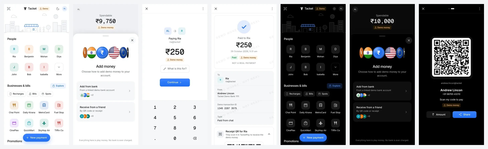
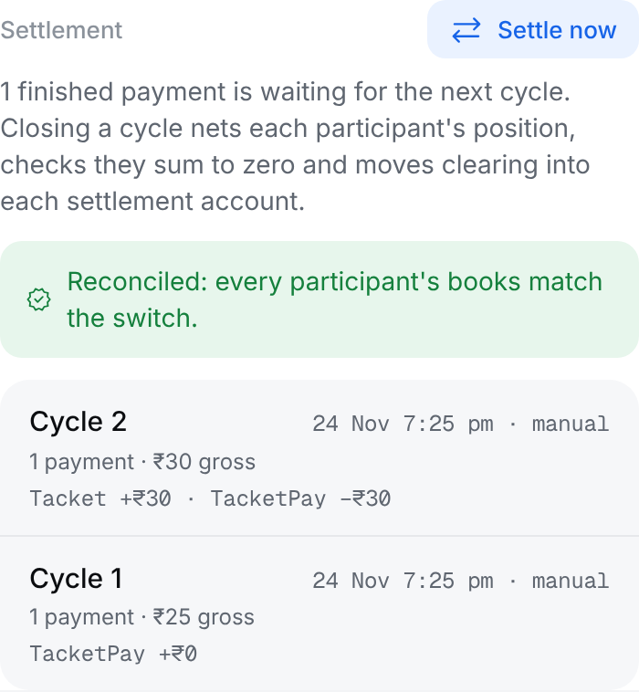

# TacketPay

**A mobile payments app that runs entirely on demo money.** Its screens and flows follow the
[GpayApp-Flutter](https://github.com/muhammad-fiaz/GpayApp-Flutter) UI kit. The visuals use the Tacket
ledger language: quiet neutral cards, monospace money and tinted status pills, with a pitch-black dark
mode. Payments run over **TPI** (Tacket Payment Interface), a UPI-style network for play money: when Diya
pays Aarush, Diya's balance goes down, Aarush's goes up, and both phones get the same receipt.

> ⚠️ **Every rupee in TacketPay is fake.** No bank, card or UPI network is connected. Balances, payments,
> rewards and receipts are demo data kept on the TacketPay server that runs this site (`data/tpi.db`).
> Receipts are watermarked "DEMO MONEY · NOT REAL", and scanning a real UPI code is refused.



## Run it

```bash
npm install
npm run dev          # http://localhost:3000
```

On Windows you can also double-click **`start-tacketpay.bat`**: it installs packages on the first run, starts the
server and opens http://localhost:3000. Keep its window open while you use the app.

Needs **Node 22.13 or newer** (Node 24 recommended): TPI stores its books with Node's built-in SQLite. The
database is created at `data/tpi.db` on first run. Stop and restart the server as often as you like; balances
and history stay. Delete that file to start the network from scratch.

It works on a laptop and on a phone:

- **Laptop (640px and wider):** a sidebar on the left (an icon rail up to 1024px, then labelled), the app as a
  full-height column in the middle, and from 1280px a wallet panel on the right with your balance, quick
  actions, recent activity and a QR code to open TacketPay on a phone. With a mouse or trackpad, the
  on-screen number pads are hidden; type amounts and PINs on the keyboard instead.
- **Phone (under 640px):** the app fills the screen. Sizing is fluid: the UI is laid out in rem against a 390px
  reference phone, and the root size follows the screen width (about 0.92× on a 360px Android, 1.12× on an
  iPhone 16 Pro Max; never below 16px on iPhone so inputs don't trigger Safari's zoom).

To use the **camera scanner** on a phone, the site must be served over **https** (browsers block cameras on
plain http, except on `localhost`). A free Vercel deploy, or `npx next dev --experimental-https` on your
LAN, both work. Without a camera you can still use **Upload from gallery**.

| Command | What it does |
| --- | --- |
| `npm run dev` | Dev server |
| `npm run build && npm start` | Production build and server |
| `npm test` | Unit tests (money maths, QR payloads, TPI payments, reversals, crash recovery, settlement, reconciliation) |
| `npm run check` | Typecheck + lint + tests |
| `npm run smoke` | End-to-end check over HTTP against a running server (see below) |
| `npm run icons` | Regenerate the Material Symbols subset after adding an icon name |

### Settings

All optional. Put them in your shell or a `.env.local` file (never commit it).

| Variable | Default | What it does |
| --- | --- | --- |
| `TPI_DB_PATH` | `data/tpi.db` | Where the SQLite books live. Created and set up automatically on first run. |
| `TPI_SETTLE_EVERY_MIN` | `60` | Minutes between automatic settlement cycles. `0` turns the timer off (you can still settle from the app). |
| `PORT` | `3000` | Port for `npm start`. |

### Check that it works

```bash
npm run check                 # typecheck + lint + unit tests
npm run build && npm start    # in one terminal
npm run smoke                 # in another: signs in two demo accounts, pays ₹25, settles, checks health
```

`npm run smoke` uses `SMOKE_URL` (default `http://localhost:3000`). It leaves two demo accounts behind,
**Diya** (mobile 98765 43210, PIN 1234) and **Aarush** (mobile 91234 56789, PIN 4321), which is handy for a
quick demo. `GET /api/healthz` answers `{"ok":true}` while the database opens and the books balance; point a
host's health check at it.

## Try TPI: Diya pays Aarush

Both people need to reach the same server. On one computer, use two browsers (or `localhost:3000` in one
tab and `127.0.0.1:3000` in another; they keep separate sign-ins). With phones, run `npm run dev` on a laptop
and open the **Network** address it prints (like `http://192.168.1.5:3000`) on each phone on the same Wi-Fi.

1. **Diya:** *Create account* with her name, a 10-digit mobile number and a 4-digit demo PIN. She starts
   with ₹10,000 of demo money, minted by TPI.
2. **Aarush:** does the same on his phone. Each now appears under the other's **People**.
3. **Diya:** tap Aarush → **Pay** → ₹250 → **Proceed to pay** → her demo PIN. TPI validates `aarush@tpay`,
   debits Diya, credits Aarush and shows the receipt.
4. **Aarush:** within about two seconds, without refreshing, he sees "Received ₹250 from Diya". His balance
   is ₹10,250, and the payment shows in his chat and history with the same RRN as Diya's receipt.

You can also pay by scanning their QR code (Profile → avatar), by mobile number (Explore → Phone number),
or by TPI ID (Explore → ID or QR code). Aarush can **Request** money, and it appears in Diya's chat with
Pay and Decline. **Settings → TPI network** shows every payment's steps, each participant's holdings
and the zero-sum check. **Settle now** closes a settlement cycle (see below).

QR codes are ordinary `https://<your-site>/q?...` links, so a phone's own camera app opens them too.

## What's in it

Everything from the reference kit, made functional:

- **Home** (the GPay arrangement): scan / logo / profile bar, an illustrated street band, a rounded
  sheet with People, Businesses & bills (shortcut chips + Explore), Promotions (including Add money),
  account shortcuts, recent activity and invite, plus a floating "New payment" pill that hides on scroll.
  Swipe right to reveal the scanner, as in the original `PageView`.
- **QR**: live camera scanner (native `BarcodeDetector`, falling back to a lazily loaded `jsQR`),
  torch toggle, gallery upload, "My QR code" with an optional amount, `/q` deep links (scanning checks the
  payee on TPI first), and a guard for real UPI codes.
- **Pay**: chat thread with payment and request bubbles → blue amount keypad → *Process to pay* sheet →
  demo PIN → TPI → animated, watermarked receipt with the RRN and TPI transaction ID.
- **Request money**: a collect request that shows up in the other person's chat with Pay and Decline.
- **TPI network** (Settings): live payments with every switch step, participant holdings and clearing
  positions, and the books-balance check.
- **Settlement and reconciliation** (TPI network screen): close a settlement cycle on demand (or let the
  hourly timer do it). Each cycle nets every participant's position over the finished payments since the
  last cycle, refuses to close unless the positions sum to exactly zero and every payment reconciles, and
  moves each participant's clearing balance into its settlement account. Reconciliation compares the
  switch's record of every payment with what each participant booked and lists any mismatch.

  
- **Explore**: People & bills (bank transfer, phone number, ID or QR, self transfer) and Businesses.
- **Bills**: categories → biller → link an account → pay the generated bill. **Mobile recharge** with
  plan tabs.
- **Rewards**: a canvas scratch card for every payment of ₹10 or more, credited when scratched. Also
  **Offers** and **Referrals**.
- **Add money**: a bottom sheet with a spinning 3D coin carousel (original flag and currency coins), two
  option cards, and step-by-step detail screens (inspired by Plasma's Add money flow). Top up from a demo bank
  with an amount, quick chips and a demo PIN, or learn how to receive from a friend.
- **Profile, Settings** (light/dark/system theme, edit name, sign out), **Payment methods**
  (add demo accounts and cards, set primary), **Check balance**, **All transactions**, and **Help**.

## Architecture

- **Next.js 16** App Router with Cache Components, React 19, Tailwind CSS v4, TypeScript.
- **TPI runs inside the Next.js server** (`src/server/tpi`), following [docs/PAYMENTS_PLAN.md](docs/PAYMENTS_PLAN.md):
  - **Switch** (`switch.ts`): a write-ahead transaction log with the states INITIATED → VALIDATED →
    DEBIT_PENDING → DEBITED → CREDIT_PENDING → SUCCESS. A payment fails before any debit, or goes to
    REVERSAL_PENDING → REVERSED if the credit fails. A 12-digit RRN is shared by both receipts.
    Unfinished payments are resumed when the server starts.
  - **Participants** (`participants.ts`): **TacketPay** (`name@tpay`, customer wallets and the only mint),
    **Tacket** (`shop@tacket`, every shop, biller and operator) and **Demo Bank Network** (`…@demobank`, bank
    transfers). Each answers ValAdd, Debit, Credit, Reversal and Final, and each is idempotent by transaction
    ID, so a retried message never moves money twice.
  - **Ledgers** (`ledger.ts`): double entry in paise. Every journal sums to zero. Wallets can't go negative
    or above ₹10,00,000. Each participant has a clearing account; their positions always net to zero.
  - **Accounts** (`identity.ts`): sign up or sign in with a mobile number and a 4-digit demo PIN (scrypt
    hashed; locks for 5 minutes after 5 wrong tries). The session is an httpOnly cookie.
  - **Settlement** (`settlement.ts`): cycles, net positions, the zero-sum rule and reconciliation
    exceptions (plan §7). Settlement is bookkeeping only: no bank is involved.
  - **Storage**: Node's built-in SQLite in `data/tpi.db` (set `TPI_DB_PATH` to move it). Hosting needs a
    persistent disk (a VM, Railway, Render or Fly volume). Serverless hosts like Vercel lose the file.
- **API**: Route Handlers under `src/app/api` (`auth/[action]`, `me`, `wallet/[op]`, `tpi/network`,
  `tpi/settlement`, `healthz`). Each change returns the person's fresh snapshot.
- **The app keeps a copy, not the truth.** `src/lib/store.ts` caches the latest snapshot in `localStorage`
  so screens open instantly. `SyncAgent` asks `/api/me?since=<rev>` every 2 seconds while the app is
  visible, which is how a payment shows up on the other phone without a refresh.
- **Money is integer paise.** `src/lib/money.ts` handles formatting (Indian digit grouping) and keypad
  input.
- **QR payloads** are in `src/lib/qr.ts`. They use UPI-style parameter names (`pa`, `pn`, `am`, `tn`) on
  TacketPay `/q` links, and every field is validated on the way in.

```
src/
  app/            routes (thin; each renders one feature component) and api/ route handlers
  components/     home, scan, pay, receipt, chat, explore, bills, recharge, transfer, promos, profile, tpi, ui
  lib/            store (cached snapshot), api (client + sync), tpi (shared types), money, qr, seed, types
  server/tpi/     switch, participants, ledger, identity, wallet (app backend), network, db
scripts/          icon subset generator, HTTP smoke test
docs/             screenshots, design notes and the TPI plan
```

Design decisions, tokens and the screen-by-screen mapping to the Flutter kit are in
[docs/DESIGN.md](docs/DESIGN.md).

## Deploying

TacketPay is a normal Node server (`npm run build && npm start`) that needs a **persistent disk** for
`data/tpi.db`. Railway, Render, Fly.io or any small VM work: use Node 22.13+ (24 recommended), the build
command `npm ci && npm run build`, the start command `npm start`, mount a volume and set `TPI_DB_PATH` to a
file on it, and use `/api/healthz` as the health check. Serverless hosts such as Vercel would lose the file.

## Limitations

TacketPay is a demo of how a UPI-style network works, built to be shown, not to hold real money.

- **Demo money only.** No bank, card, UPI or payment gateway is connected, and it should not be: running a
  real-money wallet in India needs RBI authorisation (see plan §12). The "Demo Bank Network" participant is
  a sandbox stand-in for bank transfers.
- **One process, one database.** The switch and all three participants run inside the Next.js server and share
  one SQLite file, partitioned by participant. The plan's separate services with their own databases (§8),
  signed Ed25519 messages (§4, §11) and DEEMED/ChkTxn timeouts (§3) are not built, because in-process calls
  cannot time out. The Tacket shop app's own participant lives in a separate repo.
- **The operator console is open to every signed-in person**, which suits a demo. A real deployment would
  restrict `/tpi` and the settlement API to operators.
- No SMS/OTP: accounts are a mobile number plus a 4-digit demo PIN.

## Credits and licences

- TacketPay's own code is released under the [MIT licence](LICENSE).

- Screen and flow reference, plus the money-transfer and add-card art and promo photos:
  [muhammad-fiaz/GpayApp-Flutter](https://github.com/muhammad-fiaz/GpayApp-Flutter), MIT.
  Brand logos, bank logos and people photos from that repo were **not** used.
- Icons: [Material Symbols](https://github.com/google/material-design-icons) (Apache 2.0), subset in
  `src/components/ui/icon-paths.ts`.
- Fonts: Inter and Geist Mono via `next/font` (SIL Open Font License).
- TacketPay is a design demo. It is not a bank or payment service and is not affiliated with Google Pay or
  NPCI. All businesses, billers and people in it are fictional.
